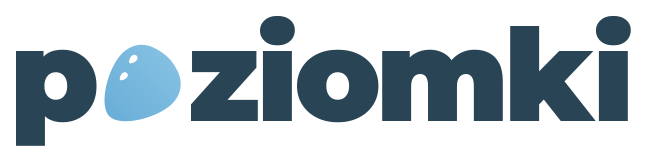
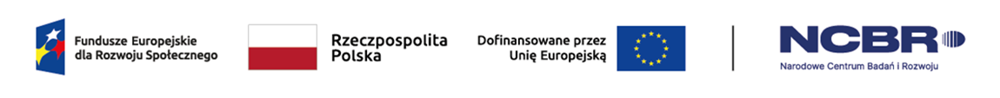

  

<a href="./README.md">pl</a> · <b>en</b>

  
  

a social app for university students, connecting people by shared interests and encouraging spending more time together through local events

## license

this project is available under AGPLv3 license

## funding

  

